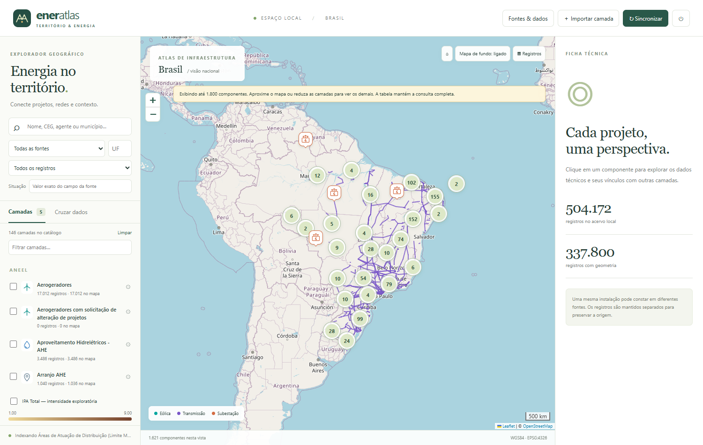

# EnerAtlas

**Mapa interativo da infraestrutura energética brasileira, com dados da EPE, ANEEL e ONS.**

Desenvolvido por **Patrick Maximo Cordeiro**.

[GitHub](https://github.com/patrick9kk) · [LinkedIn](https://www.linkedin.com/in/patrick-maximo-serafim-750729177/) · [patrickmaximocordeiro9@gmail.com](mailto:patrickmaximocordeiro9@gmail.com)

**Quer atualizar as bases?** Veja [onde encontrar os dados atuais da EPE, ANEEL e ONS](docs/ONDE_ATUALIZAR_AS_BASES.md), com links oficiais e instruções de atualização.

### [🗺️ Abrir o mapa no navegador](https://patrick9kk.github.io/eneratlas/)

Não precisa instalar nada para consultar a versão pública. Abra o link, marque as camadas e clique nos componentes para visualizar a ficha técnica.

### [⬇️ Instalar com um único executável](https://github.com/patrick9kk/eneratlas/releases/download/v1.1.2/Instalar-EnerAtlas.exe)

Baixe **Instalar-EnerAtlas.exe** e abra-o. Ele baixa o aplicativo com as dependências incluídas, reúne e verifica o acervo inicial, instala por usuário, cria atalhos e abre o mapa. **Não precisa instalar Python, Git ou usar conta de administrador.** A instalação requer internet e Windows x64.

### Baixar o repositório inteiro e instalar com dois cliques

1. [Baixe o repositório completo em ZIP](https://github.com/patrick9kk/eneratlas/archive/refs/heads/main.zip) — ou use **Code → Download ZIP** no GitHub.
2. Extraia o ZIP para uma pasta no computador.
3. Abra **Instalar-EnerAtlas.cmd** dentro da pasta extraída e aguarde. Ele faz a mesma instalação automática do executável acima.

O ZIP do repositório contém o código, a documentação e a versão web. O acervo completo, de vários GB, é baixado separadamente pelo instalador a partir das releases.

**Uma única linha no Prompt de Comando (CMD), caso já tenha Git instalado:**

```bat
git clone https://github.com/patrick9kk/eneratlas.git && cd eneratlas && Instalar-EnerAtlas.cmd
```

**No PowerShell:**

```powershell
git clone https://github.com/patrick9kk/eneratlas.git; if ($LASTEXITCODE -eq 0) { & .\eneratlas\Instalar-EnerAtlas.cmd }
```

Se já baixou e extraiu o repositório, basta executar `.\Instalar-EnerAtlas.cmd` dentro da pasta.

**Primeira instalação completa:** o acervo publicado em v1.0.0 tem aproximadamente **3,57 GB para baixar**, com 144 camadas e 1.324.499 registros. Reserve **20 GB livres** para reunir, extrair e manter os arquivos de instalação. Esse pacote é um retrato histórico; para obter dados atuais, siga [as fontes e os procedimentos de atualização](docs/ONDE_ATUALIZAR_AS_BASES.md). Uma base já instalada é preservada e reutilizada, sem baixar o acervo antigo sobre ela.

Para instalar apenas o programa e depois importar suas próprias bases:

```powershell
.\Instalar-EnerAtlas.cmd -AppOnly
```

Veja [caminhos, opções, verificação e instalação manual](docs/INSTALACAO_WINDOWS.md).

Já possui o pacote? A [versão mais recente](https://github.com/patrick9kk/eneratlas/releases/latest) permite atualizar apenas o executável, preservando as bases.

O aplicativo completo roda localmente em Python empacotado: **não exige instalar Python**. Tem cruzamento espacial, importação de novos dados e atualização pelas fontes oficiais. A interface abre no navegador padrão; o processamento acontece no seu computador.



## O que você pode fazer

- Sobrepor geração, transmissão, subestações e contexto territorial.
- Diferenciar linhas por tensão nominal em kV, com cores estáveis, legenda e nome/tensão ao passar o mouse.
- Alternar entre mapa de ruas, imagem de satélite Esri e fundo desligado.
- Consultar a ficha de cada registro, com atributos originais, nomes dos campos, aliases, unidades declaradas pela fonte, códigos de domínio, origem e data de indexação.
- Filtrar por fonte, texto, UF, situação e disponibilidade de geometria.
- Consultar os registros sem coordenadas na tabela; o aplicativo não inventa localização.
- Personalizar cor e símbolo de cada camada. Há ícones para eólicas, solares, hidrelétricas, subestações, transmissão, barragens, térmicas, gasodutos, áreas protegidas e outros componentes.
- Relacionar componentes por CEG e outros identificadores. Vínculos por CNPJ são identificados como relações do agente, sem fundir projetos.
- No aplicativo local: buscar componentes até 100 km, interseções ou elementos contidos em uma geometria.
- Exportar consultas e cruzamentos para CSV e fichas para JSON.
- Importar GeoJSON WGS84 ou CSV UTF-8 com ou sem latitude/longitude.
- Atualizar camadas oficiais pela interface e sincronizar arquivos locais concluídos.
- Visualizar uma prévia georreferenciada do raster IPA Total quando o arquivo oficial está presente.

## Navegador ou aplicativo completo?

| Recurso | Mapa público / GitHub Pages | Windows / Python local |
|---|---|---|
| Abrir sem instalação | Sim | Extrair ZIP e abrir `.exe` |
| Mapa, filtros e fichas | Sim, no snapshot publicado | Sim, no acervo indexado |
| Ícones e cores personalizados | Sim | Sim |
| Consulta dos atributos | Todos os registros das camadas admitidas no snapshot | Todos os registros importados |
| Geometria | Simplificada para consulta visual | Integral, reprojetada para WGS84 |
| Camadas grandes / curvas de nível | Catálogo informa disponibilidade no aplicativo | Importadas ao concluir o download |
| Vínculos por identificador | Nas camadas carregadas no navegador | No índice local completo |
| Cruzamento por campos | Sim, por igualdade normalizada | Sim |
| Cruzamento espacial | No aplicativo local | Sim, com geometria integral |
| Importar, baixar e atualizar fontes | Novo snapshot publicado pelo mantenedor | Sim |
| Sem internet | Não no primeiro acesso | Sim, com fundo cartográfico desligado |

**A versão online não é uma amostra aleatória.** Publica todas as linhas de cada camada admitida, com limites de 12 mil registros e 32 MB de geometria integral por camada. Camadas maiores, raster e downloads pendentes aparecem no catálogo como disponíveis no aplicativo completo. O resumo exato da publicação fica em [`site/snapshot.json`](site/snapshot.json). Geometrias da web têm tolerância de simplificação de 0,002 grau e não servem para inferir interseção, distâncias ou limites de engenharia.

## Alternativa: pacote portátil manual

1. No [pacote completo v1.0.0](https://github.com/patrick9kk/eneratlas/releases/tag/v1.0.0), baixe todas as partes `EnerAtlas-Windows-portatil.zip.partNNN` e `Reunir-EnerAtlas.cmd` para a mesma pasta. O pacote completo excede o limite de tamanho por arquivo do GitHub.
2. Abra `Reunir-EnerAtlas.cmd`: ele reúne as partes e verifica o SHA-256. Depois extraia o ZIP resultante. Se você já recebeu o ZIP completo, basta extraí-lo.
3. Para usar os recursos mais recentes, baixe o executável da [última versão](https://github.com/patrick9kk/eneratlas/releases/latest) e substitua o `EnerAtlas.exe` da pasta extraída, mantendo `data`. Depois abra o executável. As atualizações 1.1.x são compatíveis com o banco 1.0.0.
4. O navegador abre em um endereço `127.0.0.1`, acessível somente no próprio computador.
5. Marque camadas à esquerda. Abra **Registros** para consultar a tabela e registros sem geometria.
6. Clique em um componente para abrir a ficha. Em **Cruzar dados**, selecione as camadas de destino e a relação desejada.
7. Para finalizar o servidor, use o botão **⏻** no cabeçalho. Apenas fechar a aba não encerra o processo.

O ZIP pode incluir um snapshot das bases já concluídas. Sua cobertura exata, data e limitações são registradas em `COBERTURA.json`, dentro do pacote. Novas camadas só entram depois da conclusão e validação do download. As curvas de nível da ANEEL continuam sob coleta no ambiente original; o aplicativo não as apresenta como concluídas enquanto houver apenas arquivos temporários.

Dados locais, configurações e logs ficam em `data/`. O índice SQLite pode ocupar vários GB. Reserve pelo menos 15 GB livres para o acervo volumoso e suas atualizações. Para usar outra pasta:

```powershell
.\EnerAtlas.exe --data-dir D:\EnerAtlasDados --source D:\BasesEnergia
```

## Atualizar os dados

- **Sincronizar** reabre as bases locais e importa somente arquivos completos que mudaram. A verificação automática ocorre a cada dois minutos enquanto o aplicativo está aberto.
- **Fontes & dados → Adicionar pasta** registra as pastas `webmapepe` e `aneel_ons` extraídas das coletas.
- **Atualizar camadas marcadas** consulta novamente as APIs oficiais dessas camadas, salva uma cópia gerenciada e reindexa ao terminar. Uma atualização de camada grande pode durar horas. O índice anterior continua disponível para leitura.
- **Importar camada** adiciona um arquivo próprio com documentação da origem. Para atualizar uma camada própria, importe novamente com o mesmo nome.

Veja o procedimento completo em [ATUALIZACAO.md](docs/ATUALIZACAO.md). A coleta online não é executada automaticamente ao abrir o mapa; apenas a sincronização dos arquivos locais é automática.

## Executar pelo código

Python 3.12 ou superior; distribuição Windows construída e validada com Python 3.14 x64.

```powershell
git clone https://github.com/patrick9kk/eneratlas.git
cd eneratlas
python -m venv .venv
.\.venv\Scripts\python -m pip install -r requirements.txt
.\.venv\Scripts\python launch.py --source D:\BasesEnergia
```

As bases não são necessárias para abrir o aplicativo vazio e importar seu próprio GeoJSON/CSV. Para usar o snapshot público imediatamente, prefira o link **Abrir mapa**.

```powershell
# Indexar sem abrir a interface
.\.venv\Scripts\python launch.py --import-only --source D:\BasesEnergia

# Executar testes e criar o executável
.\.venv\Scripts\python -m pip install -r requirements-dev.txt
.\.venv\Scripts\python -m pytest -q
.\.venv\Scripts\python scripts\build_windows.py

# Gerar novo snapshot para o site
.\.venv\Scripts\python scripts\export_site.py --database data\eneratlas.db --output site
```

## Fontes, precisão e limitações

As fontes são oficiais, mas o EnerAtlas é um projeto independente, sem endosso institucional. ONS não publica geometria no CSV utilizado: características elétricas são consultáveis em tabela e não geram uma linha fictícia no mapa. A mesma instalação pode aparecer em mais de uma fonte e cada registro conserva sua identidade.

Na tela são exibidos até 1.800 componentes por consulta de mapa, repartidos pelas camadas selecionadas; aproxime ou filtre para ver os demais. A tabela é paginada e a exportação local inclui toda a consulta. Análises espaciais examinam até 5.000 candidatos, com aviso explícito quando esse limite é atingido. Nenhum resultado parcial deve ser interpretado como ausência de outros componentes.

Distâncias locais usam projeção azimutal equidistante centrada no projeto. Área e comprimento da ficha usam o elipsoide WGS84. São medidas exploratórias, sujeitas à precisão da fonte; para projetos muito extensos, faça validação em SIG especializado. Geometrias inválidas podem ser corrigidas topologicamente para análise, com observação na ficha; os arquivos originais não são alterados.

- [Fontes e licenças](docs/FONTES.md)
- [Arquitetura e modelo de dados](docs/ARQUITETURA.md)
- [Atualização, extensões e operação](docs/ATUALIZACAO.md)
- [Instalação no Windows com atalhos](docs/INSTALACAO_WINDOWS.md)
- [Validação e testes](docs/VALIDACAO.md)
- [Cobertura e evidências da entrega](docs/ENTREGA.md)
- [Histórico de mudanças](CHANGELOG.md)

## Contribuir e licenciar

Abra uma issue com fonte, camada, passos para reproduzir e resultado esperado. Mudanças de adaptadores devem incluir testes de CRS, contagens, geometria ausente e preservação dos dados anteriores em falhas. Não publique credenciais, configurações locais ou arquivos pessoais.

Código sob [licença MIT](LICENSE). As bases e bibliotecas conservam as licenças das respectivas fontes; a licença do código não as substitui.
